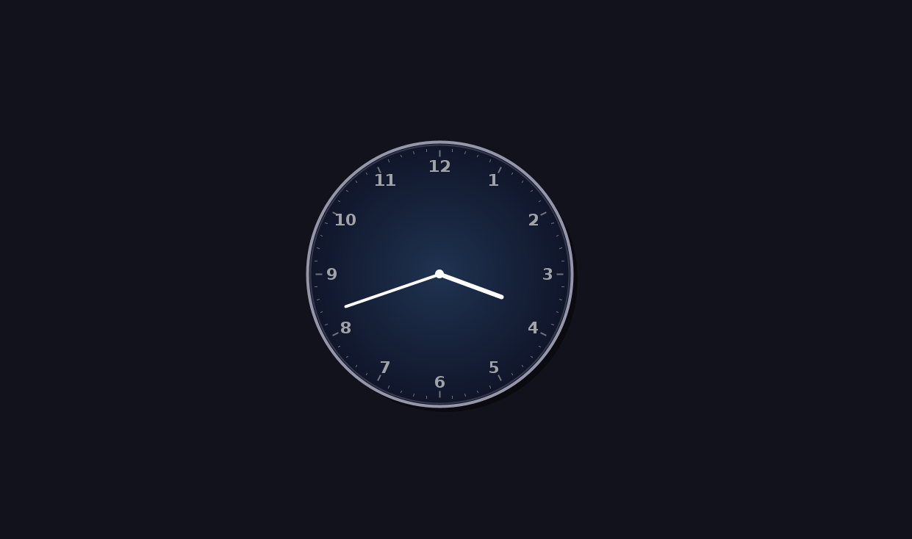
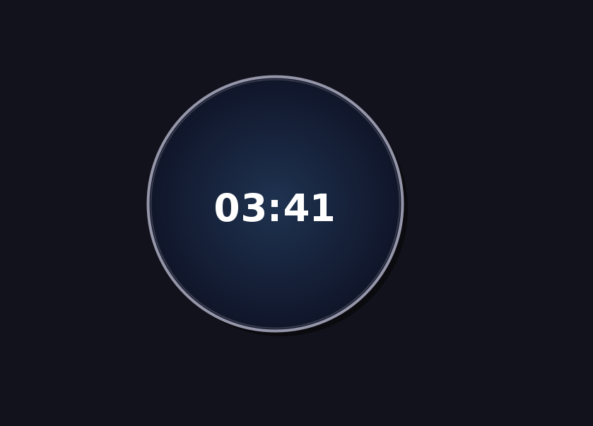
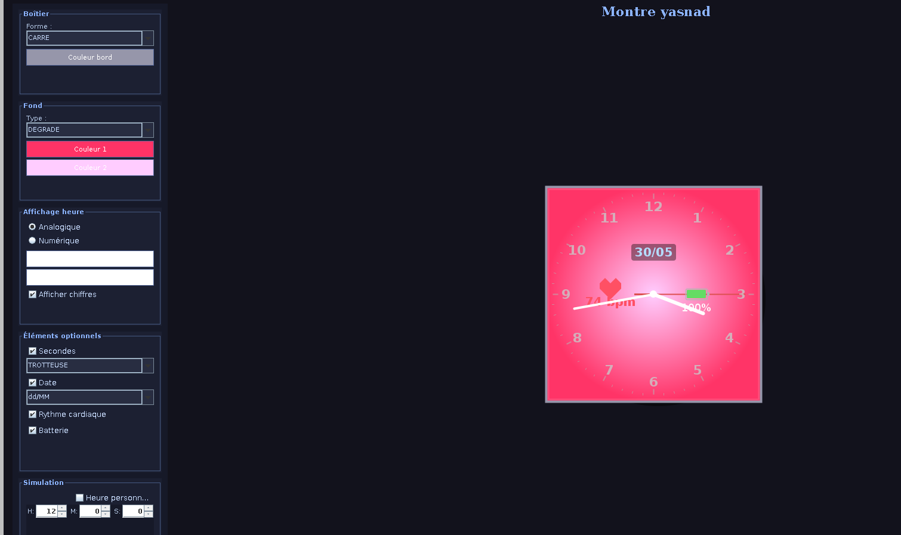

# Smartwatch Simulator

Yasnad is a Java application that simulates a smartwatch with an interactive graphical interface. You can customize the display in real time: change the watch face style, enable widgets, change colors, and even simulate a custom time. The configuration can be saved and reloaded at any time.

  

---

## Preview

---

## Features

### Time Display
- **Analog mode** — hour and minute hands, numbers 1–12, minute tick marks
- **Digital mode** — time displayed large in the center (HH:MM) in Courier New font

### Customization Panel
A scrollable side panel lets you configure everything in real time without restarting the application:
- **Case** — 3 available shapes (round, square, rounded), customizable border color and thickness
- **Watch face background** — solid color, two-color gradient, or a custom background image
- **Time display** — switch between analog and digital, show or hide the numbers
- **Optional elements** — enable/disable each widget independently
- **Simulation** — set a starting time (hours, minutes, seconds) that advances in real time

### Optional Widgets
- **Seconds** — second hand on the dial, secondary mini-dial, or numeric counter
- **Date** — 4 available formats (dd/MM, dd/MM/yy, EEE dd, EEE dd MMM), in French
- **Battery** — reads the actual level on Linux, green/red indicator depending on the level
- **Heart rate** — BPM simulation with a heart icon

### Saving
- Save and reload the entire configuration to a `.montre` file
- Accessible via the **File** menu with keyboard shortcuts (Ctrl+S, Ctrl+O)

---

## Installation & Launch

**Prerequisites:** JDK 17+

    # Clone the project
    git clone https://github.com/nada-chetloul/smartwatch-java.git
    cd smartwatch-java

    # Compile
    mkdir -p bin
    find src -name "*.java" | xargs javac -d bin -sourcepath src

    # Run
    java -cp bin montre.Main

---

## Project Structure

    src/
    └── montre/
        ├── modele/
        │   ├── Montre.java
        │   ├── ElementMontre.java
        │   ├── Boitier.java
        │   ├── FondCadran.java
        │   ├── AffichageHeure.java
        │   ├── AffichageAnalogique.java
        │   ├── AffichageNumerique.java
        │   ├── ElementDate.java
        │   ├── ElementSecondes.java
        │   ├── ElementBatterie.java
        │   └── ElementRythmeCardiaque.java
        │
        ├── vue/
        │   ├── FenetreMontre.java
        │   ├── PanneauMontre.java
        │   └── PanneauConfig.java
        │
        └── serialisation/
            └── GestionnaireMontre.java

---

## Technologies

- **Java 17** — main language
- **Swing** — graphical interface (JFrame, JPanel, JComboBox, JColorChooser…)
- **Java Serialization** — configuration saving via ObjectOutputStream

---

## Author

**Nada Cherine Chetloul** — 2nd-year Computer Science, Université de Picardie Jules Verne
